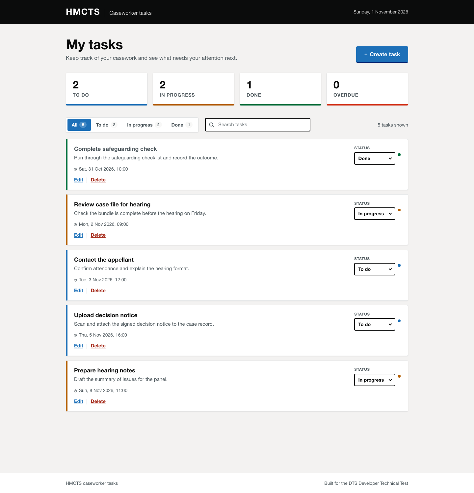

# DTS Developer Technical Test (Caseworker tasks)

A full-stack task management system for HMCTS caseworkers, built for the
[DTS Developer Technical Test](https://github.com/hmcts/dts-developer-challenge).

Caseworkers can create tasks, see what is due next, move work through
**To do → In progress → Done**, and edit or delete tasks, all from a single
responsive dashboard backed by a documented REST API.



## Projects

| Folder                 | Stack                                                                 | Tests | Docs                            |
| ---------------------- | --------------------------------------------------------------------- | ----- | ------------------------------- |
| [`backend/`](backend)   | Node.js, TypeScript, Express 5, SQLite (`better-sqlite3`), Zod, OpenAPI | 47    | [backend/README.md](backend/README.md) |
| [`frontend/`](frontend) | React 19, TypeScript, Vite, hand-written CSS                          | 41    | [frontend/README.md](frontend/README.md) |

Each folder is self-contained and can be published as its own repository: it
has its own `package.json`, lockfile, README, `.gitignore` and Dockerfile.

## Run it locally

Requires **Node.js 20.12+**.

```bash
# Terminal 1 — API on http://localhost:3000
cd backend
npm install
cp .env.example .env
npm run seed        # optional demo tasks
npm run dev

# Terminal 2 — UI on http://localhost:5173
cd frontend
npm install
cp .env.example .env
npm run dev
```

Open http://localhost:5173. Interactive API documentation is at
http://localhost:3000/docs.

## What is implemented

### Backend

- Full CRUD: create, retrieve one, retrieve all, update, update status, delete.
- SQLite persistence with a small, explicit repository layer and indexes on
  status and due date.
- Zod validation at the HTTP boundary: required/trimmed titles, optional
  descriptions, ISO 8601 due dates normalised to UTC, strict unknown-field
  rejection.
- Consistent error envelope with stable codes, correct `400`/`404`/`500`
  responses, malformed-JSON handling and a JSON 404 for unknown routes.
- Status and text filters (`?status=`, `?search=`) with parameterised SQL and
  escaped `LIKE` wildcards.
- OpenAPI 3 document served as JSON plus Swagger UI at `/docs`.
- Helmet, CORS, request logging, graceful shutdown and a `/health` check.
- 47 Vitest/Supertest tests and ~88% statement coverage.

### Frontend

- Dashboard with due-date ordering, overdue highlighting and live summary
  counts.
- Create/edit dialog with shared validation, status updates directly from each
  card, and delete confirmation.
- Status tabs with counts and instant search across titles and descriptions.
- Loading skeletons, empty/no-results states, retryable error banners and
  dismissed action errors.
- Accessible dialogs (focus trap, Escape, backdrop close, focus restoration),
  labelled fields, live regions and strong focus styles.
- Responsive from 390 px phones to wide desktops.
- 41 Vitest/Testing Library tests.

## Architecture

```
┌──────────────────────────┐        JSON over HTTP        ┌──────────────────────────┐
│  React + Vite frontend   │  ─────────────────────────▶  │  Express 5 + TypeScript  │
│  http://localhost:5173   │  ◀─────────────────────────  │  http://localhost:3000   │
└──────────────────────────┘                              └────────────┬─────────────┘
                                                                       │
                                                            ┌──────────▼──────────┐
                                                            │  SQLite (tasks.db)  │
                                                            └─────────────────────┘
```

The backend follows a thin layered structure — routes → service → repository —
so HTTP concerns, business rules and SQL can be tested and changed
independently. The frontend keeps all server communication behind a typed
`apiRequest` client and a single `useTasks` hook.

## API at a glance

| Method   | Path                    | Purpose                       |
| -------- | ----------------------- | ----------------------------- |
| `GET`    | `/api/tasks`            | List tasks (`?status=`, `?search=`) |
| `POST`   | `/api/tasks`            | Create a task                 |
| `GET`    | `/api/tasks/:id`        | Retrieve a task               |
| `PATCH`  | `/api/tasks/:id`        | Update fields                 |
| `PATCH`  | `/api/tasks/:id/status` | Update status only            |
| `DELETE` | `/api/tasks/:id`        | Delete a task                 |
| `GET`    | `/docs`                 | Swagger UI                    |

See [backend/README.md](backend/README.md) for the full contract, validation
rules and curl examples.

## Testing

```bash
cd backend  && npm test && npm run test:coverage
cd frontend && npm test && npm run test:coverage
```

Backend HTTP tests run against a real Express app with an in-memory SQLite
database (no mocked data layer). Frontend tests fake `fetch` at the network
boundary and exercise the real components, hooks and API client.

## Technical notes and trade-offs

- **SQLite** keeps the submission zero-setup and makes the test suite hermetic.
  The repository layer is the only place that knows about SQL, so moving to
  PostgreSQL would be contained.
- **No ORM** for four queries: prepared statements are clearer, fully typed at
  the boundary and easy to audit for injection.
- **No state-management library** on the frontend: one resource, one screen, a
  typed client and a small hook. Less indirection, fewer dependencies.
- **Client-side filtering** keeps search instant; the API still supports the
  same filters for other consumers.
- **Timestamps** are validated and stored in UTC, then formatted in the user's
  local timezone, avoiding ordering bugs from mixed offsets.

## If I had more time

- Pagination and sorting controls for large task lists.
- Authentication/authorisation (e.g. per-caseworker task ownership) and an
  audit trail of status changes.
- Optimistic status updates with rollback and toast notifications.
- End-to-end tests (Playwright) against the running stack and a CI pipeline
  running lint, type-check, tests and Docker builds.
