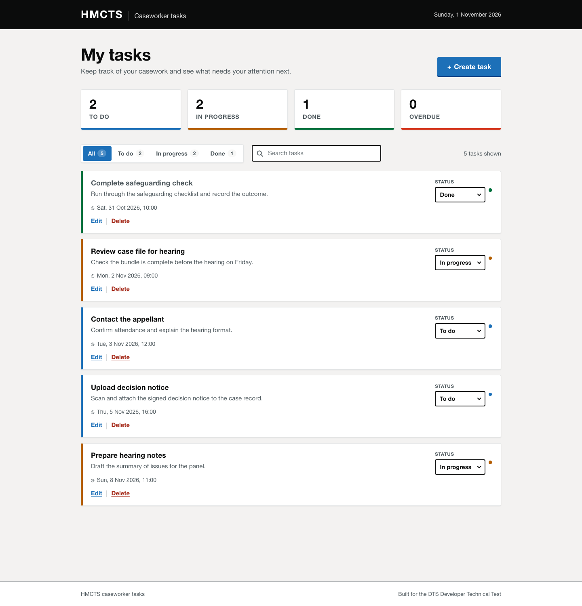

# DTS Tasks — frontend

The caseworker-facing web app for the [DTS Developer Technical Test](https://github.com/hmcts/dts-developer-challenge):
create, view, update and delete tasks from a single, responsive dashboard.



- **React 19 + TypeScript**, built with Vite
- **No UI framework or state library** — plain React, a small typed API client and CSS
- **Accessible by default**: labelled fields, keyboard-trapped dialogs, visible focus states, live regions
- **41 tests** with Vitest and React Testing Library
- Talks to the [DTS Tasks API](../backend) over REST

---

## Quick start

The API must be running first (default `http://localhost:3000`):

```bash
# in ../backend
npm install && npm run seed && npm run dev
```

Then:

```bash
npm install
cp .env.example .env
npm run dev        # http://localhost:5173
```

The app loads tasks from the API and shows a helpful error banner if the API
cannot be reached.

### Configuration

| Variable       | Default                 | Description                    |
| -------------- | ----------------------- | ------------------------------ |
| `VITE_API_URL` | `http://localhost:3000` | Base URL of the tasks REST API |

### Scripts

| Command                 | Description                              |
| ----------------------- | ---------------------------------------- |
| `npm run dev`           | Start the Vite dev server with HMR       |
| `npm run build`         | Type-check and build to `dist/`          |
| `npm run preview`       | Serve the production build locally       |
| `npm test`              | Run the test suite once                  |
| `npm run test:watch`    | Run tests in watch mode                  |
| `npm run test:coverage` | Run tests with a coverage report         |
| `npm run typecheck`     | Type-check without emitting output       |

### Docker

```bash
docker build --build-arg VITE_API_URL=https://api.example.com -t dts-tasks-frontend .
docker run -p 8080:80 dts-tasks-frontend
```

The production image serves the static build through nginx with SPA fallback.

---

## Features

- **Task dashboard** — every task ordered by due date, with a live summary of
  to-do, in-progress, done and overdue counts.
- **Create and edit** — a single accessible dialog for both flows, with inline
  validation and server-side error mapping.
- **Quick status updates** — change a task's status directly from its card
  without opening the edit form.
- **Filter and search** — status tabs with counts plus instant client-side
  search across titles and descriptions.
- **Delete with confirmation** — destructive actions require explicit
  confirmation and surface failures without losing the user's place.
- **Overdue highlighting** — incomplete tasks past their due date are marked in
  red and counted in the summary.
- **Resilient states** — skeleton loading, empty states, no-results states and
  retryable error banners.
- **Responsive layout** — two-column summary and stacked task cards on phones,
  full-width modal sheets on small screens.

---

## Project structure

```
src/
  App.tsx                 Page composition and task interactions
  main.tsx                React entry point
  api/
    client.ts             Typed fetch wrapper + ApiError
    tasks.ts              Task endpoint functions
  components/
    Header.tsx            HMCTS header with today's date
    SummaryCards.tsx      To do / In progress / Done / Overdue counts
    Toolbar.tsx           Status filters, search, result count
    TaskList.tsx          Task list and empty states
    TaskItem.tsx          Task card, inline status select
    TaskFormDialog.tsx    Create/edit dialog with validation
    DeleteTaskDialog.tsx  Destructive-action confirmation
    ErrorBanner.tsx       Retryable/dismissible error messages
  hooks/useTasks.ts       Loading and task mutations
  types/task.ts           Shared domain types
  utils/
    datetime.ts           Formatting, timezone-safe conversions, overdue logic
    tasks.ts              Sorting, filtering and summary calculations
  test/setup.ts           Testing Library setup
```

### Design decisions

- **A small custom data layer instead of a state library.** The app has one
  resource and one screen; `useTasks` plus a typed `apiRequest` covers it with
  less indirection than Redux/React Query and no extra dependencies.
- **The API is the source of truth.** Mutations replace the affected task with
  the server's response, so timestamps and normalised values stay accurate.
- **Server order, client filtering.** Tasks are sorted by due date once on
  load; filters and search run locally so typing feels instant and does not
  hammer the API (which still supports both query parameters).
- **Dates are stored in UTC and displayed in local time.** `datetime-local`
  values are converted with `Date` rather than string slicing, so DST and
  offsets are handled correctly.
- **Validation mirrors the API.** The same rules (required title ≤200 chars,
  optional description ≤2000 chars, required due date) are checked client-side
  for immediate feedback, while server `details` are mapped back onto the
  offending fields.
- **Dialogs are custom, not native `<dialog>`.** This gives predictable focus
  trapping, Escape handling, backdrop dismissal and scroll locking across
  browsers while remaining keyboard accessible.

---

## Accessibility

- Every field has a persistent label; errors are linked with
  `aria-describedby` and `aria-invalid`.
- Modal dialogs use `role="dialog"` / `role="alertdialog"`, `aria-modal`, and
  trap Tab/Shift+Tab; Escape closes them and focus returns to the trigger.
- Status updates and result counts are announced through live feedback where
  relevant; the loading state has a screen-reader-only status message.
- Focus styles use the GOV.UK yellow/black pattern and remain visible on all
  interactive elements.
- Colour is never the only signal: overdue tasks also carry a text tag and
  statuses are written out in the select.

## Testing

```bash
npm test              # 41 tests
npm run test:coverage # coverage report in coverage/
```

Coverage focuses on behaviour rather than implementation:

- **`App.test.tsx`** — loading, summary counts, filtering, search, status
  updates, create and delete flows, failed requests, retry, empty states.
- **`TaskFormDialog.test.tsx`** — create/edit submission, trimming and null
  handling, client validation, server field errors, Escape/cancel/backdrop.
- **`api/client.test.ts`** — envelope unwrapping, 204 handling, error mapping,
  network failures.
- **`utils/*.test.ts`** — sorting, filtering, summary maths, UTC/local date
  round-trips, overdue boundaries.

HTTP calls are faked at the `fetch` boundary, so the tests exercise the real
components, hooks and client code without a live backend.
